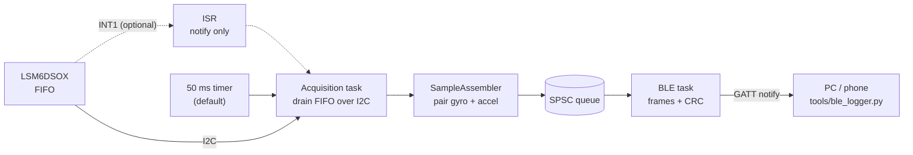

# esp32s3-wearable-imu


Firmware for a wearable motion sensor built on the **ESP32-S3** and the **LSM6DSOX** 6-axis IMU, streaming data over **BLE** to a PC or phone.
Written in C++20 on ESP-IDF with a layered architecture: all logic that does not touch hardware is unit-tested on a host machine.

> **Work in progress.** See [Status](#status) for what is verified on hardware and [docs/ROADMAP.md](docs/ROADMAP.md) for what comes next.

## Highlights

- **Custom LSM6DSOX driver** written from the datasheet. It talks to an abstract register bus (`hal::IBus`), so it is tested against a mock bus with fault injection.
- **FIFO acquisition in polling mode (default) or interrupt-driven mode (optional, INT1).** A task drains the FIFO over I2C and pushes samples through a lock-free SPSC queue ([ADR 0002](docs/adr/0002-isr-notifies-task-drains-fifo.md)).
- **Binary BLE protocol** with frame and sample sequence numbers and CRC-16, so a gap can be attributed to the radio link or to the firmware ([protocol](docs/ble_protocol.md), [ADR 0003](docs/adr/0003-binary-frames-with-crc.md)).
- **No heap allocation in the data path, no exceptions, no RTTI.**
- **Tested without hardware:** host unit tests (Unity) and Python protocol tests run in CI. The C++ encoder and the Python decoder are cross-checked on a shared golden frame.

## Architecture



| Component | Role | Hardware needed |
|---|---|---|
| `hal_port` | `hal::IBus` interface, ESP-IDF I2C implementation | I2C only in `i2c_bus.cpp` |
| `lsm6dsox` | Register map and driver (init, config, FIFO) | no (host-tested) |
| `util` | Lock-free SPSC ring buffer | no (host-tested) |
| `acquisition` | FIFO draining task (polled or INT1-driven), gyro/accel pairing | ISR and task only |
| `protocol` | CRC-16, frame and info encoding, commands, UUIDs | no (host-tested) |
| `ble_service` | NimBLE GATT server and streaming task | yes |

## Status

| Feature | Implemented | Verified on hardware |
|---|---|---|
| LSM6DSOX driver (init, ODR/range, FIFO) | yes | yes |
| FIFO acquisition, polling mode (default) | yes | yes |
| FIFO acquisition, INT1 interrupt mode | yes | no: INT1 did not trigger on my board, so it stays optional |
| BLE streaming and frame protocol | yes | yes |
| Python logger (CSV export, loss counters) | yes | yes |
| DSP: orientation, steps, fall detection | planned | - |
| Power management, offline logging, OTA | planned | - |

## Hardware

Adafruit LSM6DSOX breakout (product 4438) on I2C, address `0x6A`.

| Sensor pin | ESP32-S3 |
|---|---|
| VIN | 3V3 |
| GND | GND |
| SDA | GPIO 8 |
| SCL | GPIO 9 |
| CS | 3V3 (selects I2C) |
| DO | GND (address 0x6A) |
| I1 (INT1) | GPIO 4 (optional, interrupt mode only) |

Pins are configurable in `menuconfig` under *Wearable IMU*. Details and a troubleshooting note on `CS`/`DO` are in [docs/hardware.md](docs/hardware.md).

## Build and flash

Tested with **ESP-IDF v5.5**.

```bash
idf.py set-target esp32s3
idf.py menuconfig          # Wearable IMU: pins, I2C frequency, address, polling period / INT1
idf.py build flash monitor
```

The serial log prints acquisition and BLE counters every 2 seconds:
`smp` (samples), `irq` (INT1 edges, 0 in polling mode), `drops`, `ovr` (FIFO overruns), `bus_err`, and the BLE connection state.

## Host tests (no hardware)

```bash
cmake -S test/host -B test/host/build
cmake --build test/host/build
ctest --test-dir test/host/build --output-on-failure

python -m unittest discover -s tools -p "test_*.py"
```

Requires a C++20 compiler (GCC 11+), CMake 3.16+ and Python 3.

## Receiving data

```bash
pip install -r tools/requirements.txt
python tools/ble_logger.py --duration 30 --csv data/raw/session.csv
```

The logger connects to `ESP32S3-IMU`, starts the stream, reports sample rate, lost frames and lost samples, and writes converted data (g, dps) to CSV.

## BLE protocol in short

One GATT service with three characteristics: **Data** (notify, sample frames), **Control** (write, start/stop) and **Info** (read, sample rate and scales).
A frame carries up to 16 samples with `frame_seq`, `first_sample_seq` and CRC-16/CCITT-FALSE.
A gap in `frame_seq` means a notification was lost in the radio link; a jump in `first_sample_seq` with continuous `frame_seq` means samples were dropped inside the firmware.
Full specification: [docs/ble_protocol.md](docs/ble_protocol.md).

## Repository layout

```
components/   hal_port, lsm6dsox, util, acquisition, protocol, ble_service
main/         application entry point and Kconfig options
test/         host unit tests and mocks
tools/        Python BLE logger and protocol decoder
docs/         protocol, hardware notes, architecture decision records, roadmap
```

## Design decisions

- [ADR 0001](docs/adr/0001-use-i2c.md): I2C instead of SPI, with the bandwidth reasoning
- [ADR 0002](docs/adr/0002-isr-notifies-task-drains-fifo.md): ISR only notifies, a task drains the FIFO
- [ADR 0003](docs/adr/0003-binary-frames-with-crc.md): compact binary frames with sequence numbers and CRC

## Measurements

First end-to-end run: sensor at 104 Hz, FIFO polled every 50 ms, ATT MTU 256, a Windows PC running `tools/ble_logger.py` as the client.

| Metric | Result |
|---|---|
| Duration | 30.2 s |
| Samples received | 3140 (104.0 Hz average) |
| Frames received | 602 (about 20 per second, about 5 samples each) |
| Lost frames, lost samples, CRC errors | 0, 0, 0 |

This is a single 30 s run, and the rate is computed from the client clock. Longer runs, end-to-end latency, CPU load and power consumption are still to be measured.

## License

MIT, see [LICENSE](LICENSE).